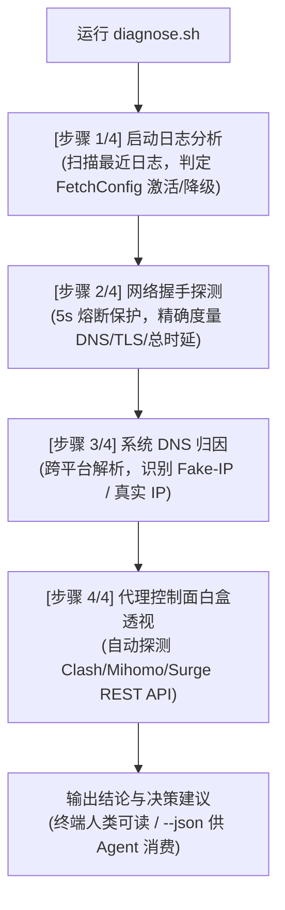

# agy-aicode-optimizer

> 🚀 **AGY CLI & Google AICode 路由优化与性能诊断技能包**  
> 专门排查与解决在 Google Antigravity CLI (`agy`) 中使用 Gemini（特别是带 Thinking Effort 的模型）响应卡顿、`FetchConfig` 超时降级、DNS/Fake-IP 延迟等问题。

---

## 📖 背景痛点

在深度使用 Google Antigravity CLI 时，很多开发者遇到了类似的问题：
1. **明明挂了海外优质节点，为什么模型首字响应极慢？**
2. **为什么 AGY CLI 启动时会有明显卡顿与降级感？**
3. **日志中频繁出现 `context deadline exceeded` 报错？**

### 核心根因定位
- **严格超时阈值**：AGY 启动阶段向 `https://aicode.googleapis.com/v1alpha:fetchConfig` 拉取实验配置和 Mendel 路由，内置了 **~1.5 秒的极短超时**。
- **TUN + Fake-IP 额外开销**：Clash/Mihomo/Surge 等代理工具在 TUN + Fake-IP 模式下，冷启动的域名反查与 TLS 握手时延极易突破 1.5 秒，导致日志中抛出：
  ```log
  CCPA routed this account to AICode, but AICode FetchConfig failed, serving CCPA's flags: context deadline exceeded
  ```
  客户端被迫降级回退到旧版 CCPA 规则，失去新后端的优化特性。

---

## ⚡ 优化前后实测效果对比

| 评估指标 | 优化前 (DNS 未调优 / Fake-IP 劫持) | 优化后 (配置过滤直连解析 / 握手缩减) |
| :--- | :--- | :--- |
| **FetchConfig 启动状态** | ❌ 报错 `context deadline exceeded`，降级为默认 flags | ✅ 成功 `serving AICode FetchConfig flags after 1.312s` |
| **API 握手总时延 (TLS + HTTP)** | ~1.5s ~ 2.1s (易偶发超时降级) | **0.97s** (稳定进入安全阈值以内) |
| **DNS 解析方式** | 虚假 IP 网段 (`198.18.0.x`) | 真实 Google IP (`172.217.x.x`) |
| **Gemini 3.8 Flash (High) 交互** | 握手卡顿，等待超时回退，波动明显 | **0~1 秒** 极速完成生成响应（多次步骤 0.0s~1.0s 即时返回） |

---

## 🏗️ 架构全景与工作流程 (v2.5)



### 工具组件清单
- **`scripts/diagnose.sh`**：统一排障主入口，完成从定性、探测、归因到白盒透视的四步闭环排查；
- **`scripts/probe_proxy_api.sh`**：零侵入只读探针，直连本地代理控制面，精确还原目标域名命中的分流规则、出口策略组与真实物理节点，并从策略组中推荐 Top 3 低延迟节点。

---

## 🛠️ 安装与使用

### 1. 一键安装到 AGY Skills

克隆本仓库到本地 AGY skills 目录即可：

```bash
git clone https://github.com/anaughtyboy/agy-aicode-optimizer.git ~/.gemini/skills/agy-aicode-optimizer
```

### 2. 运行一键诊断脚本 (v2.5)

随时在终端运行内置的自动化诊断工具进行体检：

```bash
# 人类可读终端模式
bash scripts/diagnose.sh

# Agent 结构化消费模式
bash scripts/diagnose.sh --json
```

**诊断工具自动执行四步闭环排障：**
1. **启动日志检查**：智能分析最近日志中的 FetchConfig 状态，裁决是超时降级（`degraded`）还是成功激活（`healthy`）；
2. **带熔断的网络探测**：严格探测 `aicode.googleapis.com` 的 DNS/TLS/总耗时，带 5s 超时熔断保护，杜绝挂起与 HTTP 000 假阳性误报；
3. **系统 DNS 模式归因**：跨平台（dig / getent / nslookup）归因当前解析是处于 Fake-IP 网段还是真实 IP；
4. **代理控制面白盒透视**：自动发现并只读连接本地 Clash/Mihomo（9090/9097/9091）或 Surge（6171/6170）控制面，透视 `aicode.googleapis.com` 命中的具体分流规则、出口策略组、当前物理节点及最新延迟，并列出同组更低延迟备选节点。

### 3. 可选环境变量

探针具备 100% 优雅降级能力，未配置时不影响基础黑盒探测；如需开启深度白盒透视，可按需导出：

| 环境变量 | 作用说明 | 默认值 |
| :--- | :--- | :--- |
| `CLASH_SECRET` / `MIHOMO_SECRET` | 本地 Clash / Mihomo 控制面 API 访问密钥 | 空（无鉴权尝试） |
| `SURGE_API_KEY` | Surge HTTP API 密钥 | 空 |
| `CLASH_API_URL` / `MIHOMO_API_URL` | 自定义 Clash / Mihomo 控制面地址 | 依次自适应探测 `9090`, `9097`, `9091` |
| `SURGE_API_URL` | 自定义 Surge 控制面地址 | 依次自适应探测 `6171`, `6170` |
| `AGY_LOG_DIR` | 自定义 AGY 运行日志路径 | `~/.gemini/antigravity-cli/log` |

---

## 🔧 推荐的代理 / DNS 优化配置

> [!IMPORTANT]
> 在 TUN 模式下绕过 Fake-IP 后，内核仅可见目标 IP。因此配置必须同时满足三要素：**绕过 Fake-IP** + **开启 TLS SNI 嗅战（防止域名规则失效）** + **指定海外防污染 DNS（防止本地解析污染）**。

### 1. Clash / Mihomo 配置
在配置中补充 `sniffer` 嗅探、`fake-ip-filter` 过滤及 `nameserver-policy` 防污染 DoH：

```yaml
sniffer:
  enable: true
  sniff:
    TLS:
      ports: [443]

dns:
  enable: true
  enhanced-mode: fake-ip
  fake-ip-filter:
    - 'aicode.googleapis.com'
    - 'cloudcode-pa.googleapis.com'
    - 'daily-cloudcode-pa.googleapis.com'
    - 'oauth2.googleapis.com'
  nameserver-policy:
    '+.googleapis.com':
      - 'https://1.1.1.1/dns-query'
      - 'https://8.8.8.8/dns-query'

rules:
  - DOMAIN,aicode.googleapis.com,PROXY
  - DOMAIN,cloudcode-pa.googleapis.com,PROXY
  - DOMAIN,daily-cloudcode-pa.googleapis.com,PROXY
  - DOMAIN,oauth2.googleapis.com,PROXY
```

### 2. Surge 配置

```ini
[General]
always-real-ip = aicode.googleapis.com, cloudcode-pa.googleapis.com, daily-cloudcode-pa.googleapis.com, oauth2.googleapis.com

[Rule]
DOMAIN,aicode.googleapis.com,PROXY
DOMAIN,cloudcode-pa.googleapis.com,PROXY
DOMAIN,daily-cloudcode-pa.googleapis.com,PROXY
DOMAIN,oauth2.googleapis.com,PROXY
```

### 3. Sing-box 配置

```json
{
  "dns": {
    "rules": [
      {
        "domain": [
          "aicode.googleapis.com",
          "cloudcode-pa.googleapis.com",
          "daily-cloudcode-pa.googleapis.com",
          "oauth2.googleapis.com"
        ],
        "server": "remote_doh"
      }
    ]
  },
  "route": {
    "rules": [
      {
        "action": "sniff"
      },
      {
        "domain": [
          "aicode.googleapis.com",
          "cloudcode-pa.googleapis.com",
          "daily-cloudcode-pa.googleapis.com",
          "oauth2.googleapis.com"
        ],
        "outbound": "proxy"
      }
    ]
  }
}
```

> [!TIP]
> 修改完代理配置后，需**完全退出并重启一次 AGY CLI 进程**，AGY 即可在新进程中成功在 1.5s 内拉取到最新的 AICode 路由配置。

---

## 📄 License
MIT License
